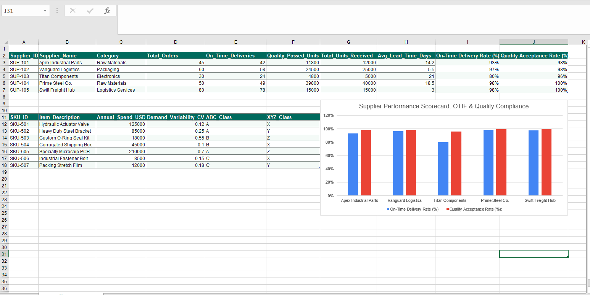

# 📦 Supplier Performance Scorecard & ABC-XYZ Inventory Segmentation

## 📌 Executive Summary
This project establishes a data-driven procurement framework combining **Vendor Performance Scorecarding** (OTIF, Quality Acceptance, Lead-Time Variance) with **ABC-XYZ Inventory Segmentation** (Annual Spend vs. Demand Volatility / CV). Designed to optimize supplier negotiations and target inventory safety stock buffers.

---

## 📊 Executive Dashboard & Analytics

### Key Analytical Highlights:
* **Vendor Risk Identification:** Isolated underperforming vendors (e.g., Titan Components at 80% OTIF and 21-day lead time) to trigger corrective action plans.
* **Dual-Axis Inventory Classification:** Segmented SKUs into AX, AZ, BX, and CZ matrices to apply tailored replenishment policies (VMI for stable high-value items vs. safety stock buffering for erratic high-spend parts like SKU-505).

---

## 🛠️ Technical Implementation & Metrics
* **Tools:** Microsoft Excel (Advanced Data Modeling, XLOOKUP, Nested IF Logic, Pivot Tables).
* **Core Formulas:**
  * **On-Time Delivery Rate:** `=On_Time_Deliveries / Total_Orders`
  * **Quality Acceptance Rate:** `=Quality_Passed_Units / Total_Units_Received`
  * **Coefficient of Variation (CV):** `=StdDev(Demand) / Mean(Demand)` for XYZ demand volatility classification.
